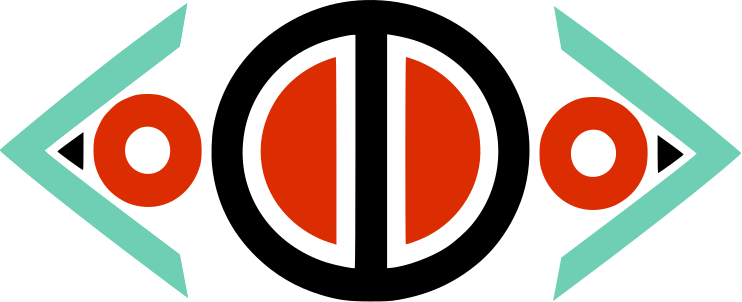

<p align="center">
  
</p>

<h1 align="center">ypy-develop/ypy</h1>

<p align="center">The hypermedia framework: any element issues a request and swaps the HTML the server returns.</p>

YPY (from Old Tupi *ypy*: origin, foundation) is a hypermedia-oriented
JavaScript framework. Any HTML element can issue an HTTP request and swap the
HTML fragment the server returns into the page. No build step, no runtime
dependencies, one script tag.

## What this is

The browser side of the YPY conversation: the core (`src/ypy.js`), the
extensions (`src/ext/`), the TypeScript types, the editor data and the Go tool
`ypy` that builds, tests, checks and migrates. The server side for Go is a
separate repository, [ypy-develop/go](https://github.com/ypy-develop/go).

The documentation lives on the website, [ypy.dev](https://ypy.dev), not in this
repository.

## Install

Load one script. `dist/` holds the built files (`ypy.min.js`, `ypy.max.min.js`
with every extension, and one file per extension under `dist/ext/`); to build
them yourself you need Go 1.26 or later:

```sh
go run ./cmd/ypy build
```

## Use

```html
<script src="/dist/ypy.min.js"></script>

<button ypy-post="/clicked" ypy-target="#result" ypy-swap="outerHTML">Click me</button>
<div id="result"></div>
```

The server answers `/clicked` with an HTML fragment, and YPY swaps it into
`#result`. Attributes are `ypy-*` or `data-ypy-*`, headers are `YPY-*`, events
are `ypy:*`.

## Learn more

- Getting started, core concepts, events, recipes for each backend: [ypy.dev/docs](https://ypy.dev/docs)
- Moving a project written before YPY: `ypy migrate --write`, then
  [ypy.dev/docs/guides/migration](https://ypy.dev/docs/guides/migration)
- What behaves differently after the move: `ypy check`
- Security checklist: [ypy.dev/docs/guides/security-checklist](https://ypy.dev/docs/guides/security-checklist)

## Develop

```sh
go run ./cmd/ypy test  # the browser tests (needs Chrome or Chromium)
go run ./cmd/ypy ci    # every gate, as in CI
```

Each command has `--help`. See [CONTRIBUTING.md](CONTRIBUTING.md) before
sending a change, [SECURITY.md](SECURITY.md) to report a problem and
[CHANGELOG.md](CHANGELOG.md) for what changed.

## License

MIT. See [LICENSE](LICENSE).
